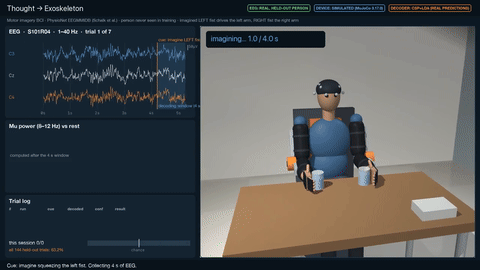
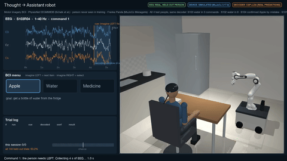
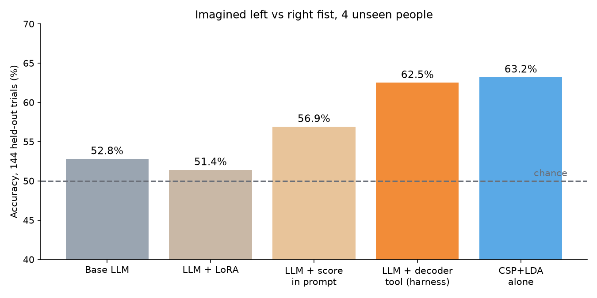
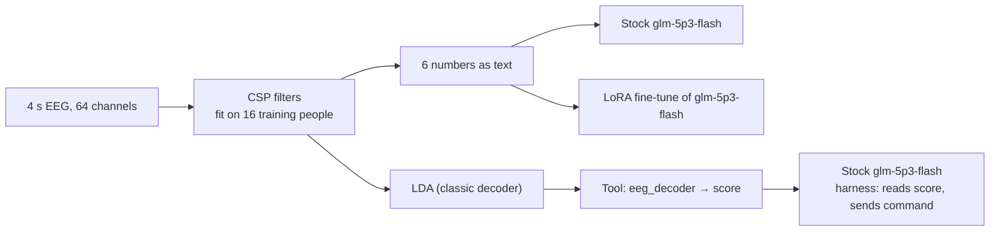

# Decoding imagined hand movement from EEG with an open model on Fireworks

| Exoskeleton: imagined fist moves the cup | Kitchen robot: fetches water from the fridge |
|---|---|
| [](videos/exoskeleton.mp4) | [](videos/kitchen_fetch.mp4) |

Click a preview to open the full video.

**Presentation:** https://claude.ai/artifact/7YkZUFVyCNvk5HtVXgTJhF

We asked whether an open LLM can tell, from 4 seconds of scalp EEG, whether a person imagined squeezing their left or right fist. We tested the person-independent case: the model never saw the test people. We measured the stock model, fine-tuned it with LoRA, then wrapped it in a harness that gives it a classic EEG decoder as a tool. Every system was scored on the same 144 held-out trials and checked with two statistical tests.

**Headline:** the LLM cannot read the brain signal itself. Stock `glm-5p3-flash` scores **52.8%** and the LoRA fine-tune **51.4%**, both at chance and both answering LEFT about 80% of the time. Given the classic decoder (CSP+LDA) as a tool, the same stock model scores **62.5%** with no training, against **63.2%** for the decoder alone. The LLM adds control, not accuracy, and costs about 0.6 seconds per decision.



Slides: [docs/deck.pdf](docs/deck.pdf) · Demo videos: [videos/](videos/)

**Disclosure.** Everything in this folder was built on the day, with AI coding assistants (Claude Code, Cursor). The test set was scored for two discarded feature formats before the final input was chosen (section 6).

## Contents

**Part 1: Submission**
1. [Problem statement](#1-problem-statement)
2. [Business value](#2-business-value)
3. [Technical execution](#3-technical-execution)
4. [Benchmark evaluation](#4-benchmark-evaluation)
5. [Latency and cost](#5-latency-and-cost)
6. [Limitations and disclosures](#6-limitations-and-disclosures)
7. [Self-assessment against the rubric](#7-self-assessment-against-the-rubric)
8. [Next](#8-next)

**Part 2: Reproduce**

9. [Setup and data](#9-setup-and-data)
10. [Runs](#10-runs)
11. [Demo videos](#11-demo-videos)
12. [Where every number comes from](#12-where-every-number-comes-from)
13. [Data, license and sources](#13-data-license-and-sources)

---

# Part 1: Submission

## 1. Problem statement

A brain-computer interface (BCI) lets a person who cannot move steer a device by imagining a movement. EEG decoders today need a calibration session with each new user before they work. We asked whether an LLM, fine-tuned on other people's data, could decode a new person with no calibration.

**The task:** two classes, imagined left fist or imagined right fist, from 4 s of 64-channel EEG.

| Input (what the LLM reads) | Output |
|---|---|
| `component 1: +1.34` … `component 6: +1.38` (6 CSP features, see below) | `LEFT` |

**Data:** [PhysioNet EEG Motor Movement/Imagery](https://physionet.org/content/eegmmidb/1.0.0/) (Schalk et al.), runs 4, 8 and 12 (imagined left/right fist), via the Hugging Face mirror `raei/Schalk-2009-EEGMotorMovementImagery`.

**Split by person:** train on S001–S016 (576 trials), test on S101–S104 (144 trials, half left, half right).

## 2. Business value

**Who needs it:** people with ALS, spinal cord injury or stroke, and the teams building assistive devices for them.

**How it runs:** the LLM is the agent and the classic decoder is the sensor. The decoder turns 4 s of EEG into a left/right score; the LLM calls it as a tool, reads the score and sends the command to the device. The two demos show this on recorded EEG from held-out people: a powered exoskeleton that lifts a cup with the decoded arm, and a mobile arm that fetches a bottle of water after the person picks "Water" from a menu with two imagined commands.

**What the result means for a product:** about 63% on two classes means roughly one command in three is wrong, which is far below what a device needs. The value of the LLM here is control logic around the decoder (ask again when unsure, wait for two matching commands, obey a spoken "stop"), not decoding. We have not built or measured that control logic yet.

## 3. Technical execution

### Turning EEG into text

We tried three text formats. The first two were scored on the test set and discarded (section 6):

| Format | How it was chosen | Test accuracy (logistic regression) |
|---|---|---|
| Band-power change vs 1.5 s of rest, 7 motor electrodes, mu and beta | first try | 47.2% |
| Left-minus-right hemisphere power, 5 electrode pairs, mu and beta | best of 4 in leave-one-person-out CV on the 16 training people (61.3%) | 54.2% |
| **6 CSP components** (common spatial patterns, fit on training people only), log-variance, z-scored with training statistics | user choice after the two above | **63.2% (LDA)** |

LDA reading the same 6 numbers scores 63.2%, the same as CSP+LDA on raw EEG. That is the ceiling for this input.

### The systems



| System | What it is |
|---|---|
| Stock LLM | `glm-5p3-flash` reads the 6 numbers and answers LEFT or RIGHT (reasoning effort low, temperature 0) |
| LoRA fine-tune | Same model, Fireworks supervised fine-tuning on the 576 training trials, rank 8, 3 epochs, answer-only targets |
| Score in prompt | Stock model, with the decoder's score pasted under the 6 numbers |
| **Tool harness** | Stock model, calls `eeg_decoder` as a tool and gives the command (`scripts/eval_harness.py`) |
| CSP+LDA | The classic decoder alone |

### Distillation runs (trained, not scored)

Following the Fireworks "import" recipe, we used the classic decoder as the teacher:

- **LDA labels:** 300 balanced training trials labelled with LDA's own answer, 6 epochs, learning rate 2e-4 (`scripts/build_distill.py`, job `ato04xmh`).
- **LDA arithmetic:** 576 trials whose target spells out LDA's weighted sum and its answer, so the model has a reasoning path to learn (`scripts/build_rationale_jsonl.py`, job `t5a06kpu`).

Both jobs completed, but the adapters were not callable before the deadline ("model does not exist" / "not deployed"). They are not scored.

## 4. Benchmark evaluation

### Test set

144 imagery trials from 4 people never used in training (S101–S104, runs 4/8/12), 72 left and 72 right. Every system sees the same trials. A missing answer would count as wrong; there were none.

### Results

| System | Accuracy | 95% bootstrap range | Answers LEFT | Above chance (binomial p) |
|---|---|---|---|---|
| Stock LLM | 52.8% (76/144) | 44.4–61.1% | 85% | 0.28 |
| LoRA fine-tune | 51.4% (74/144)* | 43.1–59.7% | 81% | 0.40 |
| Stock LLM + score in prompt | 56.9% (82/144) | 48.6–65.3% | 81% | 0.057 |
| **Stock LLM + decoder tool (harness)** | **62.5% (90/144)** | 54.2–70.1% | 65% | 0.002 |
| CSP+LDA alone | 63.2% (91/144) | 54.9–70.8% | 66% | 0.001 |

\* Two scoring runs of the same fine-tune gave 50.0% and 51.4%; the gap is run-to-run noise.

### Is each step real?

**McNemar** looks only at the trials where two systems disagree. The **bootstrap** resamples the 144 trials 10,000 times and gives a 95% range for the gap.

| Comparison | Trials gained | Trials lost | McNemar p | Gap | 95% range | Verdict |
|---|---|---|---|---|---|---|
| LoRA vs stock | 17 | 19 | 0.87 | −1.4 | −9.7 to +6.9 | No difference |
| Score in prompt vs stock | 23 | 17 | 0.43 | +4.2 | −4.2 to +12.5 | Could be luck |
| **Tool harness vs stock** | **32** | **18** | **0.065** | **+9.7** | **0.0 to +19.4** | **Borderline: just misses p < 0.05** |
| CSP+LDA vs stock | 32 | 17 | 0.044 | +10.4 | +1.4 to +20.1 | Real gain |
| Tool harness vs CSP+LDA | 0 | 1 | 1.0 | −0.7 | −2.1 to 0.0 | Same (followed the decoder on every trial) |
| LoRA vs CSP+LDA | 9 | 26 | 0.006 | −11.8 | −19.4 to −4.2 | LoRA clearly worse |

### Why the fine-tune failed

- **It changed the format but not the decision.** Answers dropped from about 140 reasoning tokens to 3, so the adapter was applied. It kept the stock model's LEFT bias: 11 of 72 RIGHT trials correct in our run, against 34 for CSP+LDA.
- **Likely causes, not tested:** the training targets had no reasoning while GLM 5.3 Flash always reasons first; 576 examples at the default learning rate are a thin signal for learning a numeric threshold. The two distillation runs target exactly these causes.

### The demos

`videos/` replays recorded EEG from held-out people into two MuJoCo simulations. The decoder is CSP+LDA with its real per-trial predictions.

- **Exoskeleton:** S101, first 7 trials in recording order, 3 of 7 correct. A wrong decode moves the wrong arm.
- **Fetch robot** (Franka Panda from MuJoCo Menagerie on a mobile base): a 3-item menu, LEFT = next, RIGHT = select, then confirm. Outcomes for all 4 test people with the same decoder: S103 water in 3 commands, S102 in 9, S104 confirmed Apple by mistake, S101 no selection in 14. The video shows S103.
- The EEG traces and scalp maps are real recordings. The devices are simulated: scripted kinematics, no contact physics.

## 5. Latency and cost

### Latency per decision

Median of 6 sequential calls from one Mac to Fireworks, plus local timing for LDA. Network time is included.

| System | Seconds per decision |
|---|---|
| CSP+LDA alone | < 0.0001 |
| Stock LLM (reasoning low) | 0.64 |
| LoRA fine-tune (3-token answer) | 0.50 |
| Tool harness (LLM call; the decoder adds < 0.1 ms) | ~0.6 |

The EEG window itself is 4 s, so the LLM adds about 15% to the time from cue to command.

### Cost

| Item | Cost |
|---|---|
| LoRA job `tjf37e7j` (576 rows, 3 epochs) | $2.54 |
| Distill job `ato04xmh` (300 rows, 6 epochs) | $2.65 |
| Distill job `t5a06kpu` (576 rows with arithmetic, 3 epochs) | $4.03 |
| **Training total** | **$9.22** |
| Scoring all systems on 144 trials, several runs | well under $1 (not itemized) |

Training costs are Fireworks' `estimatedCost` on each job (`runs/job_*.json`), not checked against the billing page. Training ran as managed SFT on `glm-5p3-flash`; the trained adapters are served with serverless LoRA, so no GPU is billed by the hour.

## 6. Limitations and disclosures

- **The test set was used to choose the input format.** The two discarded formats were scored on the test people before CSP was picked. A clean confirmation needs new people (for example S105–S108).
- **Small test set.** 144 trials give a 95% range of about ±8 points on any single accuracy.
- **One training run per setting**, one seed, default learning rate for the main fine-tune.
- **The LoRA score varies between runs** (50.0% and 51.4%).
- **The distillation adapters were not scored** before the deadline.
- **Recorded data, simulated devices.** No live headset and no real robot. The demo robot motion is scripted inverse kinematics.
- **The kitchen demo shows one of four people** (S103); all four outcomes are listed above.

## 7. Self-assessment against the rubric

| Criterion | Weight | What this project shows | Where it would lose points |
|---|---|---|---|
| Benchmark | 40% | Person-independent split; five systems on the same 144 trials; McNemar and bootstrap for every step; every run listed, including failures | The LLM never beats the classic decoder; the harness gain over stock is borderline (p = 0.065); test set touched during format choice |
| Business value | 25% | A named user group; two device demos on real held-out EEG | 63% is far below device-grade accuracy; the control logic the LLM is meant to add is not built |
| Technical execution | 20% | CSP fit on training people only; three LoRA runs including two distillations; tool-calling harness; latency and cost measured | Distillations unscored; no hyperparameter sweep |
| Presentation & demo | 10% | Deck; two 3D demos with real EEG and real decoder output | Simulated devices |
| Documentation | 5% | This file; every prediction saved; run commands below | — |

## 8. Next

1. Score the two distillation adapters.
2. Build the control logic in the harness (ask again below a confidence threshold, require two matching commands) and measure command error rate, not trial accuracy.
3. Confirm on 4 fresh people (S105–S108).
4. Give the LLM information the linear decoder cannot use: more components, frequency detail, or several trials of context per person.

---

# Part 2: Reproduce

## 9. Setup and data

```bash
uv venv --python 3.12 .venv
uv pip install mujoco mne numpy scipy scikit-learn matplotlib imageio imageio-ffmpeg pillow requests
export FIREWORKS_API_KEY=...            # never commit it
```

Download runs 04, 08 and 12 for S001–S016 and S101–S104 into `data/eeg/`:

```bash
for s in $(seq -f "S%03g" 1 16) S101 S102 S103 S104; do for r in 04 08 12; do
  curl -sfL -o data/eeg/${s}R$r.edf \
    "https://huggingface.co/datasets/raei/Schalk-2009-EEGMotorMovementImagery/resolve/main/$s/${s}R$r.edf"
done; done
```

The scripts expect a `repro/` folder next to `data/`; copy `scripts/*.py` into `repro/` before running.

## 10. Runs

```bash
python repro/features.py           # epochs and arrays for train and test
python repro/classic.py            # CSP+LDA on raw EEG
python repro/build_csp_jsonl.py    # train.jsonl / test.jsonl with the 6 CSP numbers
python repro/eval_llm.py accounts/fireworks/models/glm-5p3-flash base
python repro/eval_harness.py       # stock model + decoder tool
TESTFILE=test_harness.jsonl python repro/eval_llm.py accounts/fireworks/models/glm-5p3-flash harness_prompt
python repro/stats.py              # accuracy, bootstrap ranges, McNemar, predictions.csv
```

Fine-tune: upload `data/train.jsonl` (without the `id` field) as a Fireworks dataset and start a LoRA job on `glm-5p3-flash` (rank 8, 3 epochs). Deploy it with serverless LoRA (must be enabled on the account), then:

```bash
python repro/eval_llm.py accounts/<account>/models/<fine-tuned model> ft
```

## 11. Demo videos

```bash
python repro/set_demo_decoder.py csp_lda     # write the decoder's real predictions into the demo data
python demo/prep_eeg.py                      # real EEG traces and scalp maps for S101-S104
python demo/render_exo.py 0 7                # exoskeleton, S101 run 4, first 7 trials
python demo/render_kitchen.py S103           # fetch robot
```

The kitchen demo needs the Franka Panda model from [MuJoCo Menagerie](https://github.com/google-deepmind/mujoco_menagerie) in `assets/menagerie/franka_emika_panda/`.

## 12. Where every number comes from

| Number | File |
|---|---|
| Per-trial predictions of every system | `data/predictions.csv` |
| Accuracy, bootstrap ranges, McNemar | `data/results.json` (from `scripts/stats.py`) |
| Stock, LoRA, score-in-prompt, tool-harness runs | `data/llm_base.json`, `data/llm_ft.json`, `data/llm_harness_prompt.json`, `data/llm_harness_tool.json` |
| CSP+LDA | `data/classic_results.json`; LDA weights in `data/lda_rule.json` |
| Train and test text | `data/train.jsonl`, `data/test.jsonl`, `data/test_harness.jsonl` |
| Distillation training sets | `data/distill_train.jsonl`, `data/train_rationale.jsonl` |
| Fine-tune jobs, settings, cost | `runs/job_tjf37e7j.json`, `runs/job_ato04xmh.json`, `runs/job_t5a06kpu.json` |
| Headline chart | `docs/headline.png` |

## 13. Data, license and sources

- Data: PhysioNet EEG Motor Movement/Imagery Dataset v1.0.0, Schalk et al., *IEEE Trans. Biomed. Eng.* 2004, ODC-By. Mirror: `raei/Schalk-2009-EEGMotorMovementImagery`.
- Robot model: Franka Emika Panda from Google DeepMind's MuJoCo Menagerie.
- Fireworks "Mind the Gap" livestream (import → consolidate recipe) and the Deploy Buildathon rubric.
- Feature idea: EEG-GPT (Kim, Alaa, Bernardo, 2024), which writes EEG features as text for an LLM.
